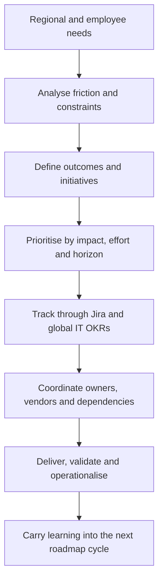
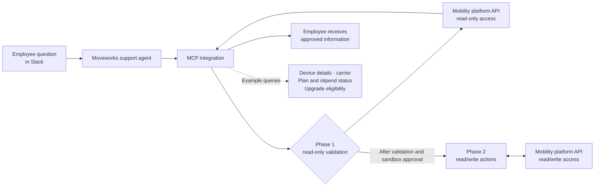

# Global Mobile Program: Roadmap and Operational Improvement
## Global service ownership · Product-style roadmap · Regional operations

**Portfolio case study · Previous employer anonymised · First-person account**  
**Program leadership:** March 2025–August 2026  
**Roadmap delivery:** 2025 roadmap completed in full; 2026 workstreams are labelled **Complete**, **In progress** or **Not started** below.

### What this case demonstrates

This case demonstrates how I turned a global mobile service’s operational needs into an OKR-aligned improvement program. It shows my ownership across regional team supervision, global prioritisation, vendor and commercial management, AI-enabled automation, and measurable delivery. The examples below substantiate these capabilities and distinguish completed results from work still in progress.

### Impact at a glance

The time savings and delivery-time improvements below were checked against the prior process during program follow-up. They are confirmed outcomes, not forecast estimates.

- **15 Payroll hours saved per month** through the stipend-report-to-Workday automation I proposed and functionally designed.
- **AI/MCP roadmap:** I designed a guarded two-phase integration; read/write was approved and working in the provider sandbox, with production rollout in progress.
- **70–96 hours saved annually** by transitioning manual China invoice processing to the mobility provider.
- **96.3% positive five-star CSAT** across **569 tickets in Q2 2026** for the Slack/Moveworks mobile-support agent.
- India device delivery reduced from **4–5 weeks to 2–3 days**; **220 knowledge articles and internal guides** reviewed and reorganised, with AI-supported updates aligning provider support content.

### Case guide

[Program scale](#program-scale) · [My role](#the-project) · [How I led the work](#how-i-led-the-work) · [Roadmap and status](#roadmap-governance-and-delivery-status) · [Impact examples](#selected-examples--ordered-by-impact) · [Evidence and capabilities](#evidence-aware-reporting)

### Program scale

- **Global footprint:** **16 mobile carriers across 15 countries.**
- **Potential eligible population:** **8,000+ full-time employees** at a global company with **10,000+ employees** could potentially receive a company-funded mobile phone line and device.
- **Active program population:** approximately **4,000 employees**—around **2,500** using a mobile stipend and **1,500** with a company-provided line and phone.

These are rounded scope figures. Potential eligibility is distinct from active enrollment; the figures do not mean that all eligible employees were enrolled.

### The project

I designed and led a global employee mobile-services program whose processes, support paths and procurement constraints varied across regions. I coordinated initiatives and vendors, and kept the work connected to company-wide objectives. I also owned vendor management for the program: annual purchase orders, contract discussions and the operating relationship with the third-party mobile-services supplier, Tango. I managed the roadmap in Jira as part of the global IT organisation's OKRs. Progress and outcomes were reported to management and senior executives through the organisation's OKR reporting.

Alongside my Senior IT Support Engineer role, I supervised **seven Mobile Ambassadors**, each responsible for day-to-day operations in their region. My remit was to lead the program, set global improvement priorities, make program-level decisions and oversee smooth cross-regional delivery. Specialist teams retained implementation of their technical components; I led the related initiative and partnered with its implementation owner.

### How I led the work

I gathered regional and employee needs, identified recurring friction, translated it into initiatives and outcomes, and prioritised work by impact and delivery horizon. I worked with regional stakeholders, internal teams and suppliers, surfaced dependencies and risks, monitored coordination and delivery, and carried completed changes into operational use. The roadmap balanced global standards with local carrier availability, procurement lead times, legal requirements and regional processes. I owned program coordination and operational validation while technical specialists retained implementation ownership.

### Roadmap governance and delivery status

The 2025 roadmap was completed in full. The 2026 roadmap puts AI at the centre of the next stage, improving mobile-service support and operations. The existing Slack/Moveworks agent was operating; the separate MCP integration with a third-party mobility platform was a 2026 initiative and remained in progress. Status for each 2026 workstream is labelled below. Apple Business Manager enrollment was completed as an MDM prerequisite; the later MDM deployment remained with the endpoint engineering team.

### Selected examples — ordered by impact

#### 1. Mobile-stipend payroll automation

Payroll raised that the monthly stipend process was consuming significant time and producing errors. I proposed automating the transfer from the recurring stipend report into Workday, designed the report and its required data model, and worked with Talent Systems to confirm feasibility and shape the solution. I led coordination across Payroll and Talent Systems, checked early payroll cycles before processing, and investigated later edge cases with the script owner to agree fixes. The Talent Systems specialist wrote the script because I did not have system access; I owned the idea, functional design, orchestration, validation and ongoing issue analysis. The workflow removed manual spreadsheet-to-system input and duplicate-payment review, with confirmed savings of **15 Payroll hours per month**.

#### 2. MCP server: guarded AI service integration

The MCP integration with the mobility platform was a **2026 roadmap initiative**, separate from the operating Slack/Moveworks support agent. I designed the solution as two deliberately gated phases: read-only queries first, followed by read/write actions after the first phase had been tested. This introduced guardrails and a safer validation path. I documented both phases; the read/write phase was approved and working in the provider sandbox, while production rollout remained in progress.

The diagram is simplified and excludes employer-specific names, internal identifiers, endpoints, data mappings and security configuration.

#### 3. China invoice-processing transition

The program transitioned manual China invoice processing to the mobility provider, confirming **70–96 hours of effort saved annually**. This confirmed operational saving is kept separate from the monthly stipend figure.

#### 4. AI support agent and service satisfaction

The mobile-support agent in Slack, delivered through Moveworks, handled employee questions. Tickets were managed in Jira, and users could complete a satisfaction survey after receiving an answer. In **Q2 2026**, across **569 tickets, the agent achieved 96.3% positive five-star CSAT**. This operating agent is distinct from the MCP integration described above.

#### 5. Cross-functional knowledge management with the service provider

Outdated documentation across our internal knowledge base and the provider’s materials was creating operational friction. I led a line-by-line review of both sets of documents and established a cross-functional way of working with the provider to keep support knowledge aligned. We replaced manual spreadsheet updates with a shared source and AI-supported automation: agreed changes were reflected in the provider’s support knowledge base, including Tango’s support content. This made updates more consistent and knowledge articles easier to review and maintain. I completed the wider documentation initiative, reviewing and reorganising **220 knowledge articles and internal guides**. No unmeasured time-saving or error-reduction figure is claimed for this workflow.

#### 6. India procurement process redesign

Device orders in India had typically taken four to five weeks to arrive. I reviewed the ordering path and coordinated a simpler process with regional stakeholders and carrier partners: orders were routed through local carrier channels and the manager-approval path was streamlined to remove bottlenecks. Delivery time fell to **2–3 days**. This was a process improvement, not a software automation claim.

#### 7. Mobile support access and service expectations

I helped restore the global mobile-support channel, updated employee-facing guidance and coordinated an **8-hour response SLA** with the mobility provider for requests submitted through the new channel.

#### 8. Global device standards and Apple Business Manager readiness

I defined global device models and appropriate stock levels for each region, including markets such as India and Brazil. I also coordinated corporate iPhone enrollment in Apple Business Manager across **16 carriers in 15 countries**, reviewing historical purchases and establishing a path for legacy devices and future purchases. The registered fleet grew from several hundred phones to around **1,500**. ABM enrollment prepared the fleet for MDM; the later MDM deployment remained with the endpoint engineering team.

#### 9. Invoice oversight controls

After a regional service interruption linked to an incorrect unpaid invoice, I helped establish a double-check and tracking workflow with mobile ambassadors responsible for oversight. Roadmap reporting recorded no overdue invoices after rollout; this is a reported operational result, not a guarantee of future performance.

### Evidence-aware reporting

The separate roadmap targets for bot-resolution rate and average ticket-resolution time are not presented as achieved. Public product and supplier names are retained where relevant; employer and tenant identifiers, internal product names, email addresses, endpoints, credentials and configuration are excluded from this portfolio summary.

### Capabilities demonstrated

Global IT program leadership · regional team supervision · roadmap ownership and delivery · AI-enabled process automation · service improvement and CSAT · vendor management · annual purchase orders and contract discussions · cross-functional stakeholder alignment · payroll workflow design and validation · mobile service operations · Jira and OKR governance · device lifecycle and procurement · knowledge management · operational risk and guardrails

This folder follows the same portfolio format as the other cases: this README is the complete case, the [executive summary](executive-summary.md) is the recruiter-facing overview, and the [evidence review](evidence-review.md) is an internal-only claim and confidentiality register.

*Confidentiality note: The employer identity, internal identifiers and sensitive operational details have been omitted or generalised. Figures are rounded where appropriate. Public product and supplier names are retained where relevant; no employee data, credentials, endpoints or security configuration are included.*
