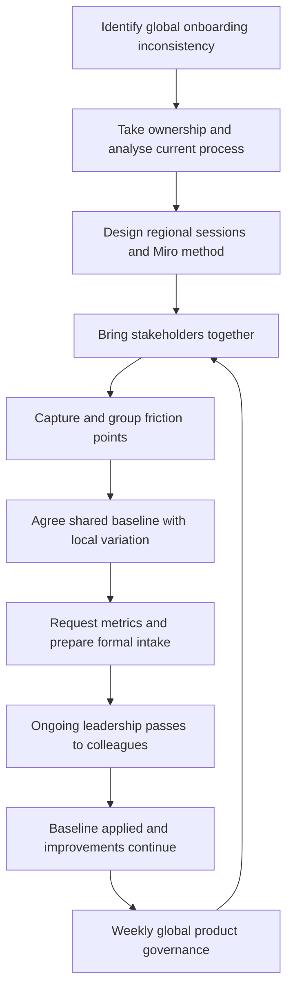

# Revamp Onboarding A to Z
## Cross-regional IT process improvement · Project leadership · Continuous improvement

### Case guide

[My initiative](#the-challenge-and-my-initiative) · [My contribution](#my-direct-contribution) · [Improvements that followed](#improvements-that-followed) · [Lifecycle](#project-lifecycle) · [Relevance](#relevance-to-senior-it-roles)

### The challenge and my initiative

I identified that employee IT onboarding varied across regions, creating an inconsistent experience and repeating the same operational problems in different teams. Because the issue was global, it needed a coordinated response and agreement across regions—not another local fix.

I took the lead in shaping the initial project. I analysed the current process, brought the right regional stakeholders together, coordinated the sessions and designed the working method. I used a Miro Board to capture and group friction points, compare regional practices, and distinguish shared issues from local constraints. I travelled to Dublin to bring local stakeholders together in person while coordinating input from APAC, AMER, India and EMEA.

The brainstorming documented 32 reported friction points across areas such as account setup, service access, hardware shipping, user guidance and task ownership. I helped the regions agree on a shared onboarding baseline that allowed for necessary local variations. I grouped the issues and opportunities and requested metrics to support a formal intake. The request is documented; receipt of the metrics and approval of the intake are not. My contribution established the foundation for the next phase. The project continued, and other colleagues later took on its ongoing leadership.

### My direct contribution

- **Recognised and framed the global problem:** Connected inconsistent regional practices to the employee experience and the need for shared ownership.
- **Designed and led the discovery:** Analysed the current process, coordinated regional stakeholders and calendars, and structured the discussions using Miro.
- **Built cross-regional alignment:** Made recurring friction visible, separated common needs from local constraints, and facilitated agreement on a shared baseline.
- **Prepared the next phase:** Grouped issues and opportunities and requested metrics to support a formal intake, without claiming that the data arrived or the intake was approved.

### Improvements that followed

The agreed baseline was applied and became a foundation for continued onboarding improvements. The subsequent work included:

- An onboarding application pre-installed on laptops through MDM, giving new joiners a consistent place to find documentation.
- Clearer, less technical instructions for new employees.
- An improved internal runbook and better coordination with Recruitment to collect the information IT operations needed to prepare and ship laptops.
- Improvements to some day-one service access; this work remained in progress.
- A global committee that treated onboarding as a product and met weekly across regions. The project remains active. I established the early foundation but did not lead the committee’s later weekly operation.

Laptop preparation and update checks were covered by a broader Zero Touch deployment initiative already underway; Zero Touch did not originate from this brainstorming. The project did not add duplicate manual preparation steps.

### Project lifecycle

The diagram distinguishes my project-shaping work from the later implementation and governance. The metrics request is documented, but the available records do not confirm receipt or formal approval. Later implementation and continued governance are based on my direct account.

### Relevance to senior IT roles

This project demonstrates how I turn a broad operational issue into a structured improvement effort: I recognised its global scope, took initiative, designed a collaborative method, aligned stakeholders and established a baseline that teams could keep improving. It also shows my ability to connect employee experience with practical IT operations, including access readiness, documentation, runbooks and laptop logistics.

I make no before-and-after performance claims because I no longer have access to the former employer’s internal data. The project remains active, but I do not claim its ongoing leadership or later governance as my work.

### Capabilities demonstrated

Cross-regional project leadership · global process analysis · stakeholder alignment · workshop design · Miro · process standardisation with local variation · MDM-based onboarding · user-centred documentation · runbook improvement · Recruitment and IT operations coordination · access readiness · continuous improvement · project handoff

*Employer and individual participants are anonymised. This case covers onboarding only; the available project evidence does not establish offboarding as part of its scope.*
