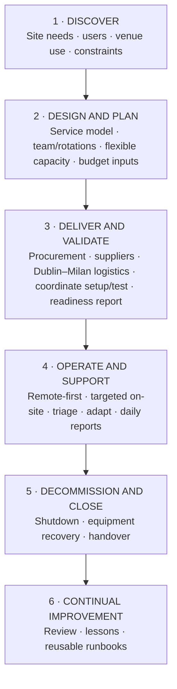

# End-to-End IT Delivery for a Major International Event
## Multi-site operations · Support-team leadership · Service continuity

**Project context: Milano Cortina 2026 Winter Olympics · Portfolio case study · Employer anonymised · First-person account · Retrospective ITIL Version 5 mapping**

### The project

I led the overall BizTech IT readiness and service-delivery project for a major international event in Milan, and directly managed the support team. I was the coordination point across AV, Network, Infrastructure and partner teams, aligning requirements, schedules and dependencies while each specialist team retained ownership of its technical tasks. The operation spanned a Dublin customer-support site handling event-driven demand, a Milan office hub for employees working in team rotations, and a fan zone that opened to the public and also hosted private partner events. Separately, I coordinated improvements at an existing Milan office that received few visits and was not used as a regular employee workplace.

The work combined operational support, service design, support-team planning, procurement, logistics and stakeholder reporting. I kept support capacity available for changing requirements and targeted improvements at the separate Milan office during quieter periods at the event sites.

### The leadership challenge

The event environment was fast-moving and frequently last minute. My job was to keep support dependable while balancing three competing needs: respond to event demand, provide an appropriate level of on-site assistance, and protect capacity for changes that could not be predicted months in advance.

I designed a **remote-support-first model with targeted on-site coverage** for both everyday support and executive needs. At the Milan office hub, I planned desk and monitor capacity for rotating teams and coordinated calendars for a limited number of private rooms. The aim was to meet executive requirements while allowing Legal, Finance, Partner Support and other teams to make effective use of the rooms.

I treated the fan zone as a variable-use venue, not simply a public event space. It opened to visitors at some times and was also used for private partner events. For the CFO's all-hands, I coordinated an AV and network setup that served people in the room and supported a global employee livestream. The setup was planned in advance, then adapted to late changes and deployed quickly after public access closed.

Another event presentation request involving the LA28 organising committee arrived overnight. At 8 a.m. I contacted the local team and went on site. With no suitable screens or monitors available, I designed the AV and sound solution, set the technical direction when stakeholders disagreed, and coordinated the move, installation, testing and user guidance within an eight-hour window. I stayed through the presentation and organised rapid teardown so costly equipment was removed before the public-facing space reopened.

### Site discovery and readiness recovery

Site visits exposed constraints that were not obvious from the initial plans. The fan zone was a historic marble venue with no infrastructure suitable for the event requirements. I coordinated the connectivity and AV plan, including the placement of Starlink and a second fibre service, with the relevant Network, Infrastructure and AV teams. A week before planned use, the Milan office hub still had setup work outstanding despite being expected to be ready. I coordinated additional cross-functional readiness work outside the original scope while protecting event-support coverage.

### Planning for uncertainty and using capacity well

I planned for operational change instead of assuming that every day or site would follow the original schedule. The support footprint and rotations prioritised the event locations, with remote support handling work that did not require physical presence. When demand eased at the Milan office hub and fan zone, available technician bandwidth could be redirected to the separate Milan office. This gave us both response capacity for late requests and useful progress on a low-visit office project without pulling people away from live support when they were needed.

The Milan office work included installation of three video-conferencing rooms that had remained incomplete after a parallel project began about a month earlier. The work was scheduled around quieter periods at the office hub and fan zone, making the team's on-site presence more productive while preserving event coverage.

### Logistics and technology

Moving equipment from Dublin to Milan presented a cost and coordination challenge: sending many individual parcels by air would have been expensive. I chose a consolidated approach using a removal company, an insured truck and ferry transport. This was a cost-conscious option; we did not quantify the savings.

The project technology scope included Neat room systems, Zoom Rooms, Cisco video-conferencing, endpoint devices, network and AV/streaming coordination. I coordinated requirements and readiness across this stack with specialist teams.

### How I ran the work

I structure this case around six project phases and map them retrospectively to **ITIL Version 5 concepts** to make the project method visible: how I moved from understanding demand to planning, delivery, live service, controlled close-out and learning. This is a retrospective mapping of my work, not a claim that the organisation formally adopted ITIL for the project. The sequence also does not imply that live support stopped between phases; support operated continuously while delivery and change continued.

- **Discover:** assess each site, user group, venue use, constraints and service dependencies.
- **Design and Plan:** define the remote-support-first model, support-team roles and rotations, site coverage, requirements, budget inputs and fallback capacity.
- **Deliver and Validate:** coordinate procurement, suppliers, cross-border logistics, setup dependencies, readiness checks and handover into operations.
- **Operate and Support:** manage the support team, intake, triage, changing priorities and stakeholder reporting; coordinate specialist workstreams while each team owns its technical tasks.
- **Decommission and Close:** plan phased shutdown, equipment recovery and handover.
- **Continual Improvement:** capture fixes as reusable runbooks and lessons for future service planning.

I also use ITIL Version 5's four dimensions to show the breadth of the service: **Organisations and people** (support-team design and stakeholders), **Value streams and processes** (readiness through support and close-out), **Information and technology** (workplace, network, AV and collaboration requirements), and **Partners and suppliers** (specialist teams, vendors and connectivity providers).

Support ran alongside live operations. I managed support-team roles, site assignments, working-day coverage and rotations; oversaw intake and triage; adjusted priorities; and sent daily status reports to stakeholders, including global IT leadership. Across other technical workstreams, I served as the coordination point, aligning dependencies and handoffs while each specialist team owned its own tasks.

### Results and corroboration

My former employer's performance review recognised the support plan, hardware procurement, supplier onboarding, training materials and cross-functional coordination, and described operations as seamless, without service interruptions or delays. Jeff Galisky's peer recommendation corroborated continuity, fallback planning and delivery reliability. These are attributed reports, not independently audited uptime results. His recommendation is available from [my LinkedIn profile](https://www.linkedin.com/in/cesarouton/).

The event was described to me as a multimillion-euro investment; my remit was the IT readiness workstream.

### Scale at a glance

- **Planning horizon:** approximately eight months.
- **People in scope:** more than 200, based on my account as deployment coordinator.
- **On-site work:** approximately 40 days in Milan, based on my account.

This README is the project overview. The complete case, with the lifecycle, workstreams, challenges and evidence boundaries, is in [`lifecycle-and-workstreams.md`](lifecycle-and-workstreams.md). For a fast recruiter-facing read, see the [executive summary](executive-summary.md). ITIL terminology is linked to [PeopleCert's ITIL Foundation (Version 5)](https://www.peoplecert.org/browse-certifications/it-governance-and-service-management/ITIL-1/itil-5-foundation-version-50-4154).

### Capabilities demonstrated

IT service readiness · multi-site service delivery · support-team design and coordination · resource and rota planning · remote-first support · executive support · incident/request triage · AV and streaming coordination · room and workplace technology · procurement and supplier onboarding · logistics planning · stakeholder reporting · contingency planning · decommissioning · runbooks · ITIL lifecycle thinking

### Portfolio boundaries

The event is public and named; the employer and its branded event-space name are omitted. Specialist teams retained ownership of their engineering implementation. This case omits supplier identities, exact addresses, security configurations, purchase references and private commercial terms. First-hand account and source-attributed outcomes are identified in the evidence and wording controls in the complete case.
