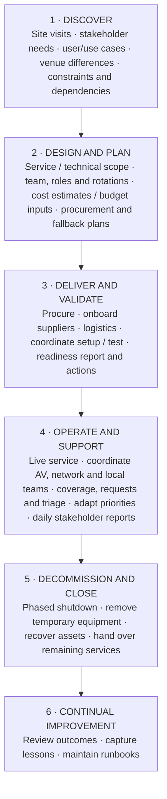

# End-to-End IT Delivery for a Major International Event
## Complete Case Study · Milano Cortina 2026

This is the complete project case study, covering the project context, my remit, all lifecycle phases, cross-functional workstreams, challenges, outcomes and evidence boundaries. For the concise recruiter-facing version, see [`../executive-summary.md`](../executive-summary.md). The employer is anonymised. I map the work retrospectively to ITIL Version 5 to explain the service lifecycle and management practices; this does not mean the organisation formally adopted ITIL for the project.

## Context and my remit

The event support footprint connected a Dublin customer-support site handling event-driven demand, a Milan office hub for rotating teams, and a fan zone that opened to the public and also hosted private partner events. Separately, I coordinated improvements at an existing, low-visit Milan office that was not used as a regular employee workplace. Planning began about eight months before kickoff. I spent approximately 40 days on site and coordinated support for more than 200 people, based on my first-hand account as deployment coordinator.

I led the overall BizTech IT readiness and service-delivery project and directly managed the support team. My remit included requirements, venue readiness, equipment and service planning, procurement and supplier onboarding, support-team design, live service, stakeholder reporting, and decommissioning and recovery planning. I was the coordination point across AV, Network, Infrastructure and partner teams, aligning requirements, dependencies, schedules and handoffs. Each specialist team and supplier retained ownership of its own technical tasks and implementation.

## The operating challenge

The environment was highly changeable and very last minute. Fixed event dates left little flexibility, while requirements, equipment timing and connectivity dependencies could shift. I had to adapt priorities, team assignments and service coverage without losing sight of readiness across the locations.

Two examples of the live challenges—the CFO all-hands and an overnight LA28 request—are described in Phase 4.

The work sat within a wider support model that covered everyday employee issues through complex on-site executive needs. I designed support as remote-first, with targeted on-site coverage, to reduce the number of people who needed to be physically present while retaining support for both standard users and executives. The Dublin customer-support site handled additional event-driven demand. At the Milan office hub, I planned desk and monitor capacity for more than 200 employees rotating by team, and coordinated calendar use of limited private rooms to meet executive needs while making them available to Legal, Finance, Partner Support and other teams. The fan zone had a distinct dual use: open to the public at some times and used for private partner events at others. This operating context required flexible coverage and clear ownership as needs changed.

## Lifecycle flow

**Sequence note:** the readiness report is the handoff from delivery into live service. Support is shown alongside operation because requests, troubleshooting and executive assistance happened throughout live operations, not in a later stage. Continual improvement follows close-out; its lessons inform future discovery and design.

## Phase 1 — Discover

**Purpose:** understand users, outcomes, locations, constraints and dependencies before deciding what to deliver.

**My work:** I began planning well before kickoff and assessed the locations through site visits. I clarified the different roles of the Dublin customer-support site, Milan office hub and public fan zone, then captured requirements for work areas, meeting rooms, video conferencing, signage, executive needs and local infrastructure. At the fan zone, a historic marble venue with no infrastructure suited to the event, I coordinated with AV, Network and Infrastructure teams on what services and equipment were needed and where they could be placed. The connectivity plan included Starlink and a second fibre service. I treated improvements at the existing low-visit Milan office as a separate workstream, including three video-conferencing rooms left unfinished by a parallel project started a month before the event. I also accounted for the fan zone's changing use as a public space and private partner-event venue.

**Challenge and response:** each location served a different audience and purpose, and the wider environment was subject to urgent changes. I gathered requirements by use case instead of assuming that one standard layout or support pattern would fit all sites. The fan zone required connectivity and AV planning for a venue not originally equipped for this type of event. I also planned for uncertainty by preserving response capacity and opportunities to redeploy bandwidth, allowing the team to handle event changes while using quieter windows for office improvements.

**Outputs:** site and user requirements; known constraints; initial dependency map; questions and handoffs for specialist teams and suppliers.

## Phase 2 — Design and plan

**Purpose:** turn needs into a service model that specifies coverage, ownership, process, technology and operational measures.

**My work:** I designed and managed the support operating model around a remote-support-first approach with targeted on-site coverage. I sized the support coverage required, managed support-team roles and site assignments, planned working-day coverage and rotations, established user intake and triage, and defined service measures. I built capacity into the plan to adapt to late changes instead of allocating every available technician hour in advance. For the Milan office hub, I planned desk and monitor arrangements for more than 200 employees rotating by team. I coordinated calendar-based use of limited private rooms, balancing executive requirements with access for Legal, Finance, Partner Support and other teams. When demand at the Milan office hub and fan zone was lower, that planned bandwidth could be directed to the separate Milan office for inspection and improvement work. I also coordinated equipment selection and placement with site use, plus workplace, network, video and signage dependencies.

I planned for the full support spectrum: routine employee issues, location-based technical needs and executive assistance. Because urgent requests could change the plan, I designed coverage and coordination so priorities and assignments could be adjusted during delivery. I defined measures such as device availability and ticket-resolution time, but do not have verified targets or numerical results to publish.

**Outputs:** service scope; roles and coverage model; site assignments and rota; intake and triage; stakeholder reporting approach; service measures; technology requirements; readiness and fallback planning; capacity to absorb changes and redeploy technician bandwidth; close-out approach.

## Phase 3 — Deliver and validate

**Purpose:** make the designed service ready through procurement, partner coordination, logistics, deployment and validation.

**My work:** the employer's performance review credits me with hardware procurement, supplier onboarding, training materials and cross-functional alignment. As the BizTech project coordination point, I aligned readiness with AV, Network and Infrastructure colleagues and partner teams, including setup sequence, delivery windows and dependencies. Those teams owned and delivered their specialist tasks; I ensured support arrangements and cross-team handoffs were built into delivery.

**Logistics decision:** equipment had to move from Dublin to Milan. I judged that sending multiple individual parcels by air would be too costly, so I selected a consolidated removal-company shipment in an insured truck transported by ferry. This was a cost-conscious option; we did not quantify the savings.

**Challenges and response:** the fan zone had no event-ready connectivity or AV infrastructure, so we coordinated Starlink, a second fibre service and AV requirements with specialist teams. The office hub was still incomplete a week before use, requiring additional work outside the original scope. Separately, a peer recommendation describes late hardware, delayed fibre and a power outage before kickoff. I adapted sequencing and maintained fallback options so the overall readiness effort could continue. The sources do not establish the detailed technical design of those alternatives, so I do not claim specific configurations or network implementation.

**Outputs:** procured equipment and onboarded suppliers; coordinated logistics and setup; support and training materials; readiness validation; delivery status, open risks and readiness handoff to operations.

### Event technology scope

The project stack included Neat room systems, Zoom Rooms, Cisco video-conferencing, endpoint devices, network dependencies, AV and streaming. I coordinated requirements, readiness and handoffs across these workstreams.

## Phase 4 — Operate and support

**Purpose:** coordinate a stable live service as locations open and user needs evolve.

**My work:** I managed the overall BizTech IT workstream and support team across the event footprint: the Dublin customer-support site handling extra event-driven demand, Milan's rotating-team office hub and the fan zone. My on-site presence was approximately 40 days, based on my account. The service supported more than 200 people, also based on my first-hand account as deployment coordinator. I managed support-team assignments and rotations, request intake and triage, and stakeholder visibility. I remained the coordination point for AV, Network, Infrastructure and partner teams, each of which retained ownership of its technical tasks. The support model prioritised remote resolution and used on-site coverage where needed. At the office hub, room calendars helped allocate scarce private rooms to executives and other teams. Support activities ran continuously alongside operations; they were not a later phase.

**Challenge and response:** the CFO all-hands had to serve two audiences at once: employees in the fan zone and employees joining the global livestream. The venue also remained a public-facing space, so we had to plan for rapid setup after public access ended. Although the event was planned ahead, changes arrived late; I acted as the coordination point across AV, Network and other teams to align changes and deployment; each specialist team delivered its own technical tasks. Separately, the LA28 request arrived overnight, with an eight-hour window before the presentation. That venue had no suitable monitors or screens, and stakeholders disagreed on the proposed approach. I assessed the need, set the technical direction, coordinated moving and installing equipment, testing and user guidance, then stayed on site during the presentation. I also organised rapid removal afterwards because the public-facing space could not be left with costly equipment in visitor areas.

**Reported outcome:** the employer's review described IT operations as seamless, without service interruptions or delays. Jeff Galisky's peer recommendation also reported continuity of service. These are attributed reports, not an independently audited uptime figure.

**Measures:** I defined service indicators including device availability and ticket-resolution time. The reviewed evidence does not establish exact SLA targets, ticket volumes, measured resolution results or rota headcount; those should not be inferred.

## Phase 5 — Decommission and close

**Purpose:** close temporary operations in a controlled way, recover equipment and transfer useful knowledge.

**My work:** I included phased decommissioning, equipment recovery and handover in the project plan. Jeff's recommendation describes me taking ownership of the decommission plan. Planning notes include proposed dates and routes for equipment; they are not a final asset reconciliation.

**Evidence boundary:** no complete post-event inventory or independently reviewed asset close-out was located. Use “planned and coordinated decommissioning and recovery”; do not claim every item was reconciled or returned.

## Phase 6 — Continual improvement

Jeff's recommendation says I turned fixes into reusable runbooks so others could repeat them. That supports a knowledge-transfer and continual-improvement outcome. The evidence does not quantify the number of runbooks, adoption rate or reduction in repeat incidents.

## ITIL Version 5 dimensions across the work

| Dimension | Application in this case |
|---|---|
| Organisations and people | Support-team sizing, roles, site assignments and rotations; remote-first support with targeted on-site coverage; daily stakeholder communication; support from everyday users through executives; coordination with specialist teams |
| Value streams and processes | Discovery, readiness, procurement, intake and triage, live support, last-minute adaptation, recovery and runbooks |
| Information and technology | Workplace requirements, network and connectivity dependencies, video conferencing, AV, streaming and signage |
| Partners and suppliers | Specialist engineering teams, event stakeholders, vendors, hardware suppliers and connectivity providers |

The lifecycle gives the case its end-to-end structure, while the four dimensions make the people, process, technology and partner dependencies visible across every phase. They are applied throughout the project rather than treated as separate workstreams. This is a retrospective use of ITIL Version 5 concepts for portfolio presentation, not evidence of an organisational ITIL implementation.

## Evidence and wording controls

- **Employer review:** supports the support plan, hardware procurement, supplier onboarding, training materials, cross-functional coordination and the reported no-interruption/no-delay outcome.
- **Jeff Galisky's LinkedIn recommendation:** peer corroboration for delivery reliability, continuity, fallback planning and reusable runbooks. He was a cross-functional colleague, not my manager; the text was supplied in my career evidence and was not independently authenticated during this review.
- **My direct account:** more than 200 people in scope, approximately 40 days on site, team/rotation and daily reporting details, CFO all-hands AV/streaming requirements, overnight LA28 request and eight-hour AV/sound deployment and teardown, and wider event investment context.
- **Planning and promotion materials:** support the lifecycle, workstream and planning scope. Proposed room/equipment quantities are not treated as installed counts.
- **Financial scope:** the multimillion-euro figure describes the wider event context as reported to me; no IT budget or personal control over total event spend is claimed.
- **Anonymity:** the event is public and named; the employer and its branded event-space name are omitted. Internal project identifiers, vendor names, exact addresses, security configurations and commercial terms stay private.

For the project overview, summary diagram and concise leadership account, see [`../README.md`](../README.md). The official ITIL reference is [PeopleCert ITIL Foundation (Version 5)](https://www.peoplecert.org/browse-certifications/it-governance-and-service-management/ITIL-1/itil-5-foundation-version-50-4154).
