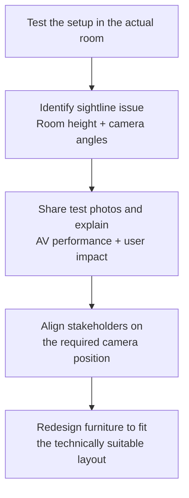
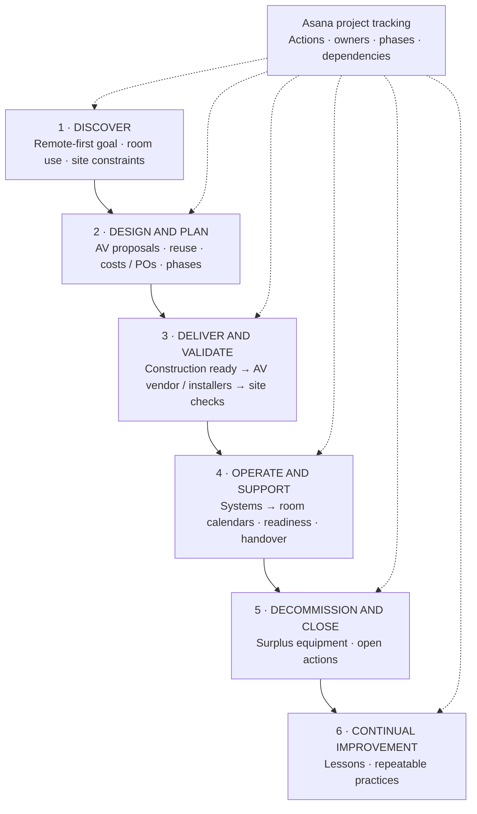

# Infrastructure Project Management: HQ Workplace AV Refit
## Infrastructure project management · Workplace technology · Cross-functional delivery

### Project objective

The project took place at the company's headquarters and supported remote-first work, optional office attendance and global team gatherings. Workplace set room dimensions and capacities. As Infrastructure Project Manager, I led the client-side AV workstream through its full lifecycle, from discovery and planning to delivery, operational handover and closeout.

### My role

As Infrastructure Project Manager, I was accountable for client-side delivery of the AV workstream. I coordinated the vendor, schedule, dependencies, procurement, installers, issue follow-up, readiness and handover, and approved AV spend within my remit. I worked with construction, Workplace, Real Estate, architects and Systems; additional budget needs went to the overall-project team. The AV vendor retained specialist design and installation execution, while Workplace set room dimensions and capacities.

I tracked actions, owners, phases and dependencies in Asana and ran weekly vendor reviews and stakeholder meetings, sometimes twice weekly. The project lasted approximately three to four months, with around four to five site visits, based on my account.

### End-to-end delivery and lifecycle

I managed the work from requirements and site constraints through planning, procurement, installation coordination, validation, operational readiness, handover and decommissioning. The lifecycle below describes the sequence; in practice, coordination and readiness checks overlapped across phases.

Construction and AV work depended on each other. I coordinated the schedule so the vendor knew when rooms would be accessible—for example, arranging AV installation after carpentry was complete. I tracked progress, equipment deliveries, issues and support needs, then followed them through with the responsible specialists.

Workplace defined the room dimensions. I proposed equipment selection and placement with technical input from my AV project partner, assessed what could be reused, upgraded or retired, and referred specialist questions to the AV engineer. When costs exceeded the AV spend I could approve, I worked with the team responsible for the overall project to identify additional budget; I did not own the total project budget.

I coordinated with Systems to create the new rooms as calendar resources and add them to the relevant calendars. I managed site validation, readiness communication and handover, then coordinated decommissioning of surplus equipment.

### Delivery challenge: protect the user experience

One additional room needed agreement on its use and setup, including TV size and camera placement. I flew to the HQ to test the proposed setup in the actual room. Its height and camera angles would have compromised the view during use. I ran tests, shared photos and explained the impact on AV performance and user experience. After aligning stakeholders around the evidence, we agreed the cameras needed a different position and redesigned a piece of furniture to accommodate it. The decision prioritised the value of the AV investment and the user experience over an aesthetic preference.

*Anonymised reconstruction of the decision sequence from my account; this is not an original room photo, plan or installation drawing.*

### Results and scope

Career-review and promotion materials describe three modern gathering spaces delivered on schedule, with AV reused and upgraded. This is an attributed internal outcome, not an independently audited service or financial metric. Project records separately describe two Zoom Rooms, a boardroom and circulation areas; I preserve both scope descriptions because the records do not establish a one-to-one mapping.

The available evidence does not provide reliable cost savings, incident counts or other quantified operational results. I have not estimated them. The supported outcomes are the reported on-time delivery and AV reuse/upgrade, room readiness and calendar setup, surplus-equipment decommissioning, and the camera-placement decision backed by real tests and a furniture redesign.

### Delivery method

I use the ITIL Version 5 lifecycle retrospectively as a portfolio framework for explaining the work. It was not necessarily the organisation's formal project method.

1. **Discover** — understand the remote-first goal, room use, site constraints and dependencies.
2. **Design and Plan** — develop AV proposals, review reuse, align phases and costs, and agree roles and dependencies.
3. **Deliver and Validate** — coordinate construction readiness, vendor access, orders, installers, issue resolution and site checks.
4. **Operate and Support** — work with Systems on room calendars, communicate readiness and hand over support context.
5. **Decommission and Close** — coordinate surplus-equipment removal and close project actions.
6. **Continual Improvement** — carry forward room-by-room planning, explicit reuse review, dependency tracking, vendor check-ins and readiness validation.

Asana was the project-management tool used to track actions, owners, phases and dependencies across these stages. In the lifecycle diagram, it is shown as a cross-project tracking layer, separate from AV technology and design.

The solid arrows show delivery sequence and handoffs: construction readiness enables vendor installation, Systems makes rooms bookable, and validation precedes handover. Dashed arrows show Asana's use across the lifecycle.

### Evidence and publication boundaries

Career records, reviews, travel records, planning workbooks and project notes support project management, vendor coordination, procurement context, site activity, phased delivery, QA and handover. Details such as meeting cadence, spend approvals within my remit, calendar-resource setup, surplus-equipment decommissioning and the camera tests are based on my account; the camera test photos and decision record were not independently reviewed.

The employer and vendor are anonymised. Internal identifiers, names, source documents, room plans, equipment models and quantities are omitted.

### Capabilities demonstrated

Infrastructure project management · client-side AV workstream ownership · vendor management · construction schedule coordination · purchase orders and spend approvals · Asana project tracking · Zoom Rooms · equipment selection and reuse assessment · room calendar setup · Systems coordination · on-site validation · issue resolution · surplus-equipment decommissioning · stakeholder communication · ITIL lifecycle thinking

Employer: anonymised.
