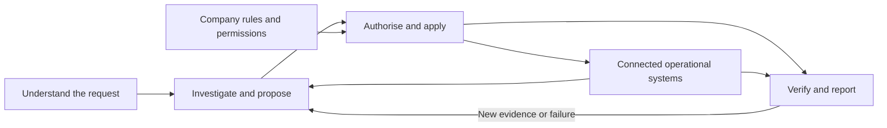

# ORBIT

### From an operational request to a verified result

**César Outón Leiro · AI automation and IT operations · October 2026**

When someone misses an on-call shift, finding an available replacement is only the beginning. The replacement must have the right skills, enough rest and an affordable engagement. Several systems must agree on the outcome. During an incident, updating the ticket is easier than proving the service has recovered.

I designed ORBIT to address this coordination problem: an AI assistant investigates, compares options and requests actions, while company-controlled rules determine what it may change. The intended value is less manual follow-up, fewer duplicate actions and fewer jobs closed before their outcome is confirmed.

**This is a personal solution-design portfolio with simulated journeys and fictional operational data.** It presents the architecture and decision-making approach; it does not report production outcomes.

## My contribution

I led the operational definition and AI-assisted iteration of the project. Over several weeks, I invested **more than 100 hours**, based on my estimate of the total effort.

I translated operational requirements into three sets of artefacts:

- **Rules and authority:** who can approve an absence, commit spending or authorise an exception; which constraints remain mandatory.
- **Integration contracts:** what each system must expose, what a change means and what evidence a connector must return.
- **Acceptance criteria:** how to distinguish an accepted request from an applied change, and an applied change from a verified outcome.

Three design choices illustrate my ownership: permissions stay outside the AI model; missing information remains a constraint; and service recovery is checked separately from incident-ticket status. Code construction was AI-assisted. My focus was directing the solution, challenging inconsistent assumptions and defining how its behaviour should be evaluated.

## A decision worth automating

A coverage coordinator receives authorised absence requests that leave future shifts uncovered. The first available replacement fails the rest requirement. Moving another person would open a gap elsewhere. External support is possible, but consumes a limited budget.

ORBIT should compare valid internal and external options, explain why an option was rejected and request only the changes within its authority. After a change, it checks the affected schedule again. If another coordinator changes a shift in the meantime, it refreshes the plan rather than overwriting that work.

Success means verified coverage within the applicable constraints—not a fixed number of hires or a predetermined sequence of tools.

## How it works

These are responsibilities, not a requirement to deploy a service for every box. Connectors provide access to existing systems. A separate execution gate checks authority and conditions before changes. Verification then examines the resulting state.

The chat interface is replaceable: the prototype used Mattermost as a no-cost option, while the same design could connect to Slack or Microsoft Teams through their supported APIs. HR data could come from Workday or another HR platform through an authorised API connector. Each integration needs its own permissions, data mapping and validation; the policy and verification responsibilities stay the same.

The [architecture](docs/architecture.md) explains budget reservations, concurrent changes and safe recovery when only part of a plan succeeds.

## The same approach, a different problem

An incident operator investigates a critical service outage, commonly called a P1. In the simulated example, traffic reaches port 8081 while the application listens on 8080. ORBIT compares correcting that mismatch, redirecting traffic and reverting the deployment.

The proposed choice depends on evidence, risk and permissions. Recovery requires checks of the service and its external access path; changing the incident status alone is insufficient. The [scenario walkthroughs](docs/scenarios.md) show both journeys and their failure branches.

On-call scheduling and incident response illustrate extensibility. Another domain would need its own validated connectors, rules and success criteria. Priority and urgency select applicable company rules; they do not create additional authority.

## What this package contains

| Material | Status |
|---|---|
| Architecture, operational rules and simulated journeys | Presented in this documentation |
| Recovered source snippets from the original project | Reviewed as background; not included or presented as a complete implementation |
| Integrated runtime matching this portfolio | Not demonstrated by this package |

Historical deterministic laboratory results are not used as evidence that an AI model independently chose the illustrated actions. The public package is deliberately documentation-only.

## How I would assess value

I would compare representative cases against a manual baseline, using the same constraints and recording human assistance. Proposed measures include correctly verified objectives, unsafe actions prevented, valid actions incorrectly blocked, duplicate effects and time spent coordinating versus waiting.

An independent reviewer should be able to identify the request, authority, change and observed result from the record. That makes quality assessable even when there is more than one valid solution.

ORBIT shows how I approach automation from operational responsibility: define the outcome, connect the necessary information, anticipate failure and decide what evidence makes completion trustworthy.

## Read more

- [Technical architecture](docs/architecture.md)
- [Two simulated operational journeys](docs/scenarios.md)
- [Caso de portfolio en español](docs/case-study.es.md)

## Additional portfolio case study

[Milano Cortina 2026 — IT readiness, multi-site operations and delivery leadership](Portfolio/milano-cortina-2026/README.md)
